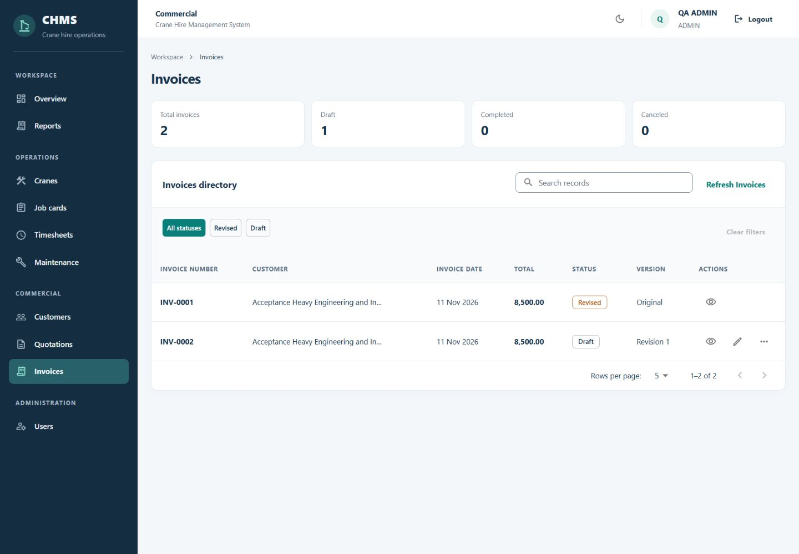
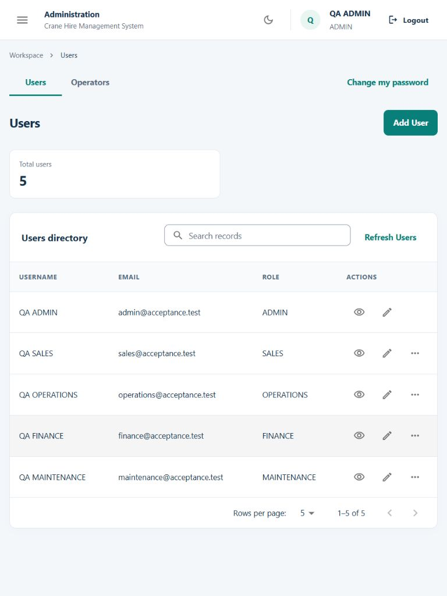
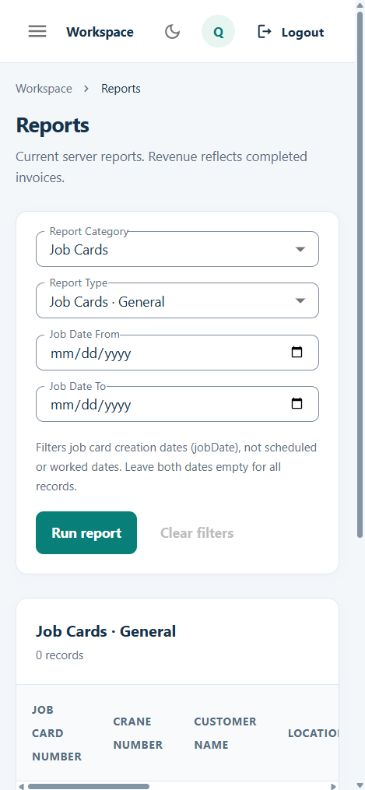

# Crane Hire Management System (CHMS)

Internal operations software for crane hire: fleet and customer records, quotations, job cards, timesheets, maintenance, invoices, reporting and user administration.

## Application Screenshots

| Invoice Management | User Administration | Reports |
|---|---|---|
|  |  |  |

## Architecture and workflows

A Java 21 / Spring Boot 4.1.1 REST API uses Spring Security JWT authentication, JPA/Hibernate and PostgreSQL. The React 19 / TypeScript client uses Vite, Material UI, React Router, TanStack Query, React Hook Form and Axios. Role permissions cover ADMIN, SALES, OPERATIONS, FINANCE and MAINTENANCE; authorization is enforced by the backend. Registration is internal administration rather than a public customer portal. The browser holds the token in memory, so refreshing the page requires signing in again.

Pending job cards permit timesheet changes. Completing a job requires timesheets and generates an invoice. Crane scheduling checks booking and maintenance conflicts. Completed or canceled maintenance is immutable through update. Invoice lifecycle, revisions and calculations are enforced by the backend.

## Local setup

Requirements: JDK 21 or newer supporting release 21, Node compatible with Vite 7 (this review used Node 24.22.2), npm, PostgreSQL, and Docker Desktop with Linux containers for integration tests. Maven Wrapper is included.

Create a local PostgreSQL development database named `crane_management_system`, or configure another database URL. Configure `DB_PASSWORD` and a long, randomly generated `JWT_SECRET` in the backend process environment; never commit credentials. See `src/main/resources/application.properties` for the default local database URL and user; override with `SPRING_DATASOURCE_URL` and `SPRING_DATASOURCE_USERNAME` where needed. The backend does not load a root `.env` file automatically. The application uses Hibernate schema update, so startup should target only your intended development database.

A fresh database has no default account. An initial ADMIN account must be provisioned separately using a BCrypt password hash and trusted local database tooling, or an existing development account must be supplied. There is no public registration or automatic admin bootstrap. Afterward, the admin can manage users through the application; no reusable login credentials are included in this repository.

Windows PowerShell backend: `.\mvnw.cmd spring-boot:run` (port 8080 by default). On Linux/macOS, use `./mvnw spring-boot:run`.

Frontend: from `frontend`, run `npm ci`, then `npm run dev`. Vite proxies `/api` to localhost:8080; set `BACKEND_URL` to override the development proxy. The production build needs a host routing `/api` to the backend and SPA fallback routing.

## Verification

From `frontend`: `npm run test`, `npm run test:doctor`, `npm run typecheck`, `npm run lint`, `npm run format:check`, `npm run build`.

From the root: `.\mvnw.cmd clean verify` (Linux/macOS: `./mvnw clean verify`). Database tests use disposable PostgreSQL Testcontainers, including the application context smoke test. Start Docker Desktop first. Never point test fixtures at the application database.

The latest completed verification, recorded on 11 November 2026:

| Check | Verified result |
| --- | --- |
| Backend | 562 tests passed; 0 failures, errors or skips |
| Frontend | 316 tests passed across 9 files; 0 failures or skips |
| JaCoCo | All configured coverage thresholds met |
| Frontend quality | Typechecking, ESLint, Prettier and production build passed |
| Browser acceptance | Chromium at 375, 768, 1280 and 1440px; 45 live API role checks passed |

See [the audit findings](docs/final-quality-audit/README.md) and [visual acceptance report](docs/final-quality-audit/visual-acceptance-review.md) for evidence and limits. These results describe completed local runs. Tests cover services, controllers, repositories, security, API contracts and user workflows.

## Screenshots and limitations

Sanitized screenshots and actual browser/viewport coverage are available in [the visual acceptance review](docs/final-quality-audit/visual-acceptance-review.md). Cross-browser, real-device and screen-reader follow-up remain manual checks. Directory filtering and pagination are client-side. No production deployment or public demo is claimed.

The [portfolio readiness review](docs/final-quality-audit/portfolio-readiness.md) records a limited credential-pattern scan of current files and reachable Git history. This does not replace a full security review or confirm that historical example values were never used outside the repository.
